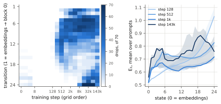

<!-- trackC_writeup/draft-C2.md — rendered by `python -m trackC_writeup.numbers render` from draft-C2.src.md and numbers.json; edit the source, not this file. -->

# When a language model's interaction energy stops rising with depth

**Abstract.** In the particle picture of self-attention, tokens are particles on a sphere and,
under identity weights, their interaction energy E_β never decreases with depth. We count the
layer-to-layer drops in E₁ at 18 checkpoints of `pythia-410m` and of its nine PolyPythias
seeds, on seven prompts. The count is zero through step 128 on seed 0 and
reaches half its early plateau at step 512; a prediction registered before the seeds'
intermediate checkpoints were downloaded put each seed's break at 256 or 512, and it held on
9 of 9. E₁'s first-order term is half the squared norm of the tokens' mean, and at
every drop from step 128 to 1000 that term falls and is most of the drop. With each prompt's
mean token removed, the count breaks later, at 1000 on
seed 0 and on eight of the nine seeds, the step at which the previous-token and
induction heads are dated. Editing every head's OV map (its symmetric part, its rotation removed,
or its step-128 map) does not undo the break. Every dated event falls inside the learning-rate
warmup, and neither a different peak rate (`pythia-70m`, `pythia-160m`) nor a different warmup
(Mistral's GPT-2 small) separates the dates from the schedule. The results are exploratory except
the registered seed count, on one model size, seven hand-picked prompts and a grid with no
checkpoint between 512 and 1000.

## 1. Introduction

Read a transformer's depth as time and its tokens as particles on a sphere, and self-attention
becomes an interaction between them [Geshkovski et al. 2023]. Under the simplest weights (one
head with Q = K = V = I, the same in every layer) the particles attract and cluster, and the
interaction energy E_β of §2.1 never decreases with depth. That picture organises a growing
theory of clustering and metastability (§8). Trained language models do not follow it: at the
end of its training, `pythia-410m`'s E₁ falls between consecutive layers 70 times over
our seven prompts, out of 24 × 7 layer-to-layer
transitions. No theorem is broken, since none covers a trained model (§2.1),
but the picture's prediction fails, and nothing says when along training it starts to fail, or
what else is changing then.

We read E₁ layer by layer at 18 checkpoints of `pythia-410m` and of nine retrained seeds,
counting V, the drops between consecutive layers (§3). We report two dated events, their place on
the model's developmental order, and one negative result:

1. **The break, dated and reproduced (§4).** Through step 128 E₁ is monotone in depth on every
   prompt (V = 0 on seed 0); V reaches half its 1000–4000 level at step
   512. A prediction registered before any seed's intermediate checkpoints were
   downloaded put the break at 256 or 512 on each of nine PolyPythias seeds, and it falls there on
   9 of 9. The date is the recipe's, not one run's; with seeds that share the
   recipe this was the expected outcome, and the registration guards only against choosing the
   window after seeing them (§3.4).
2. **The token-centred cloud breaks later (§4.1).** E₁'s first-order term is the squared norm of
   the tokens' mean (§2.1). With each prompt's mean token removed before normalising, the centred
   count at 512 on seed 0 is 0.19–0.24 of its own late level, where the uncentred
   count is at 0.98 of its own; the centred cloud's break comes at
   1000, on seed 0 and on eight of the nine seeds at every tolerance
   read: one grid step after the break on the seeds that break at 512, two on those that break at
   256. That is the step at which the previous-token and induction heads are dated. The two counts'
   sizes are not compared, only their dates. What the mean carries is read from E₁'s series
   instead, after the dates: at each of the 1224 drops from step 128 to 1000, on
   every seed, ‖m‖² falls, and its term is more than half the drop at all but
   one.
3. **The timeline (§5).** On seed 0 the break comes after the token cloud's rank collapse (step 8)
   and the unigram minimum (128); the bigram minimum (256), the fall in the OV maps' attractive
   share (512) and the previous-token and induction heads (1000) are each within one grid step of
   it, which we count as aligned, not ordered, since these are different kinds of quantity dated
   by different statistics (item 2's two counts are one statistic, §4.1). **"Break, then induction, then the OV maps'
   repulsive phase" is not shown:** in either reading of that phase it ties the break or induction
   on this grid.
4. **One intervention, no reversal (§6).** Making every head's OV map symmetric, or removing its
   rotation, does not take the break back towards monotone at any step after it; giving every
   head its own step-128 OV map lowers V at 512 and 1000 but leaves it far from monotone. The
   break is neither shown to be the OV maps' nor shown not to be.

**What none of this separates (§7).** Every dated event from step 128 to 1000 falls inside the
learning-rate warmup, which runs to step 1430 and which all ten runs share. Two
further runs do not separate a training event from the schedule. On `pythia-70m` and
`pythia-160m`, which warm up over the same steps at higher peak rates, both dates are consistent
with the count of updates and with the cumulative learning rate, and the centred date excludes
the rate itself. On
Mistral's GPT-2 small, whose warmup is logarithmic and longer, the break's larger rise falls where
the count of updates predicts, after a smaller first rise where the cumulative rate does, and the
label the rule fixed before that run gives turns on two of its choices (the plateau window and one
tolerance of the centred count). So the dates are dates inside a warmup, not training events told
apart from it.

Everything here is exploratory, on one model size, seven hand-picked prompts and a
grid with no checkpoint between 512 and 1000; only the seed count of §4 was registered. §2 gives the
energy and the exact conditions under which it is monotone, §3 the setup, §8 related work;
appendix A reads the heads' shared subspaces along the same steps, appendix B the gate each
reading passed before it was read, and appendix C what the count is made of (by prompt, by
layer, without the frame-changing transitions, and E₁'s net change).

## 2. Background

### 2.1 The energy, and when it is monotone in depth

Put each token's residual-stream state on the unit sphere, xᵢ ∈ S^{d−1}, i = 1, …, n, and let

  E_β(X) = (1 / 2βn²) Σᵢ Σⱼ exp(β ⟨xᵢ, xⱼ⟩).

E_β is large when the tokens are close together and is maximised by a single cluster; over
probability measures on the sphere its minimiser is the uniform one [Geshkovski et al. 2023,
Prop. 3.4]. Read a transformer's depth as continuous time for an interacting-particle system,
with self-attention the interaction. When every layer has the same single head with Q = K = V = I,
the dynamics are a gradient ascent of E_β in a metric that reweights the tokens, so E_β is
non-decreasing in depth [Geshkovski et al. 2023, §3.2]; with V = −I it is non-increasing. Wider hypotheses give monotonicity of a different, weighted energy, not of E_β:
for one head whose score matrix QᵀK is symmetric and equal to V, the dynamics ascend
(1/2β) Σᵢⱼ exp(β⟨Vxᵢ, xⱼ⟩) in a metric that weights each token by its attention normaliser
[ibid., §3.4.1], and for many heads whose score matrices are each symmetric and equal (or close)
to their value maps, a sum of energies weighted by those matrices is non-decreasing [Pendharkar
2026, Theorems 11–12], though a single head's own energy can fall through cross-head terms
[ibid., Theorem 17]. No result covers MLP blocks, values untied from the scores, weights that
change from layer to layer, or discrete layers, and trained transformers satisfy the symmetry
and tying conditions nowhere exactly [ibid., §10].

So no theorem says a trained language model's E_β should be monotone in depth, and none says
a randomly initialised one's should. We read monotonicity as the prediction of the
identity-weight picture, and a drop in E_β between consecutive layers as a departure from that
picture, not as the violation of a theorem. That a model at initialisation is (almost) monotone,
and a trained one is not, is then an empirical fact about this model, which §4 dates.

E_β sums over all pairs of tokens, so its first-order term is the tokens' mean. With
m = (1/n) Σᵢ xᵢ, expanding the exponential gives, exactly,

  E₁ = ½ + ½ ‖m‖² + Σ_{k≥2} (1 / 2n² k!) Σᵢ Σⱼ ⟨xᵢ, xⱼ⟩ᵏ,

where ‖m‖², the squared norm of the mean, is a standard measure of anisotropy (§8). The higher
terms are not small (|⟨xᵢ, xⱼ⟩| ≤ 1, and the n diagonal terms are 1), so E₁ is not ‖m‖², but a
drop in E₁ between layers can come from the mean shrinking alone. §4.1 removes the mean.

### 2.2 The developmental order

Language models acquire their internal structure in stages. In a small two-layer attention-only
model, Hoogland et al. [2024] find bigram statistics first, then positional use and common 3- and
4-grams, then previous-token heads, then induction heads, then a long stage with no significant
change, each stage a period of change in the local learning coefficient. Induction heads form at
the point where in-context learning improves abruptly, visible as a bump in the training loss
[Olsson et al. 2022]. On Pythia, a model's loss
on sequences sampled from unigram and bigram statistics falls to a trough between steps 2⁶ and
2⁸ and rises until about 2¹⁰ [Belrose et al. 2024], and task-level components emerge at similar
token counts across model sizes [Tigges et al. 2024]. §5 places the energy's break on this order
for one model, `pythia-410m`, with every row dated by the same locator.

### 2.3 Pythia's training, and its warmup

The Pythia models are trained for 143 000 steps of 1024 sequences of 2048 tokens
[Biderman et al. 2023], with the learning rate warmed up linearly over the first
1 % of training (1430 steps) and decayed by a cosine to
0.1 of its peak; the peak is 3 × 10⁻⁴ for `pythia-410m`,
6 × 10⁻⁴ for `pythia-160m` and 10⁻³ for `pythia-70m` [Biderman et al.
2023], and the released training configs give the two smaller models the same warmup
(1430 steps for 160m, 1430 for 70m). The suite
releases checkpoints at steps 0, 1, 2, 4, 8, 16, 32, 64, 128, 256, 512 and then every 1000 steps. Every early event
§4 and §5 date, the energy's break included, therefore falls inside the warmup, and nothing in
one schedule separates a change caused by training from one caused by the schedule. Li et al.
[2025] tie the first of their three geometric phases to the same ramp. PolyPythias [van der Wal
et al. 2025] retrains `pythia-410m` from nine further seeds with the same schedule, which lets
§4 ask whether the break's step is the run's or the recipe's, but not whether it is the
schedule's (§7).

## 3. Setup

### 3.1 The model, the checkpoints and the prompts

`pythia-410m` has 24 layers of width 1024, each with 16 attention
heads (384 in all); each block adds its attention and its MLP to the residual
stream in parallel, and positions enter through rotary embeddings [Biderman et al. 2023]. We read
18 of its checkpoints, steps 0, 2, 4, 8, 16, 32, 64, 128, 256, 512, 1000, 2000, 4000, 8000, 16 000, 32 000, 54 000, 143 000. Step 1 is left out: in our runs its
outputs are identical to step 0's (we did not compare the weights), so it adds no point. There is
no checkpoint between 512 and 1000, or between 1000 and 2000, so nothing below dates a change more
finely than the grid.

PolyPythias [van der Wal et al. 2025] retrains `pythia-410m` from nine further random seeds,
`pythia-410m-seed1` to `pythia-410m-seed9`, with the same code, data and schedule but a different
initialisation and data order, and releases the same checkpoints; we call the original run seed 0. PolyPythias reports two of the nine, seeds
3 and 4, as outlier runs; we keep both and flag them, as fixed before any of their
checkpoints was read.

Every seed and step reads the same seven texts: a passage of Camus's *L'Étranger* in
French, a method from the Python source of the HDBSCAN library, a passage of the *Iliad* in
English translation, the source of a LaTeX document, a paragraph from a paper on transformers,
Sullivan Ballou's 1861 letter to his wife, and a Wikipedia paragraph on Charlotte Brontë, each
cut at 512 tokens (prompt-set hash `976b62d677bc`). They span two
languages, prose, verse, code and markup, but they are few and were chosen by hand, not sampled,
and every count below is a count over these seven.
Forward passes run in float32 with TF32 off, on one GPU. On seed 0 the
per-state energies reproduce an earlier CPU run of this project to a relative
1.5 × 10⁻⁶, and the counts of §3.2 exactly.

### 3.2 The energy and the drop count

At each checkpoint and prompt we take the residual stream's 25 states as the model
returns them: the token embeddings, the outputs of the first 23 blocks, and the
last block's output after the final layer norm. Each token's vector is normalised to unit
length, so a prompt's n tokens lie on the sphere, and E₁ of §2.1 (β = 1) is computed at each
state, every position included. A step from one state to the next is a *drop* when E₁ falls by
more than a fraction 10⁻³ of its value. **V**, the statistic of everything below, is
the number of drops at one checkpoint: over the 24 transitions of each prompt, summed
over the 7 prompts, so at most 24 × 7. Two of the
transitions change frame as well as layer (the embeddings into the first block's output, and the
last block's output into the final layer norm); they are counted like the rest, they hold none of
the drops from step 256 to 1000 on any seed, and V counted without them dates every seed's break
at the same step (appendix C). V is not one prompt's: at each seed's break no prompt holds more
than 0.24 of it (an even split is 0.14). And a drop is a dip, not a net fall: on
every prompt, seed and step, E₁ is higher after the last state than at the embeddings (appendix
C, with figure 5's map of where the drops sit). In the identity-weight picture V is 0. A drop is a departure from
that picture's prediction, not the violation of a theorem (§2.1). The tolerance keeps float
noise out of the count; on seed 0 the break's date below is 512 at each of the
tolerances 10⁻⁴, 10⁻³ and 10⁻², and 512 with any one prompt left out.

β = 1 is the one setting seed 0 had been read at before the seeds were registered (§3.4); no
other β is read in this frame. A second energy, E₃.₅ in each block's input frame (after its
first layer norm, positions 1 to n − 1, blocks 0 to 23), is read beside it in §4
and never counted; β = 3.5 is a value we fitted earlier to this model's attention scores, and
the frame is the one attention reads.

### 3.3 Dating the break

Let m be the median of V over steps 1000, 2000 and 4000. The break's step is the first grid
step at which V ≥ m / 2, a *half-rise*. The plateau is early on purpose: V keeps moving late in
training (on seed 0, 57 on the plateau and 70 at the last step), and a
reference taken there would let a late rise move an early date. Read after the dates with the
plateau at 8000–32 000 instead (median 59–74 drops by seed), every seed's
half-rise stays in (128, 512] and only seed 9 moves, from 256 to
512 (appendix C). Two other rules were set aside
on seed 0 before the seeds were read: the first step with V > 0 moves with a single stray drop,
and V's change-weighted centroid in log step lands at about 827 on seed 0,
pulled late by the rise between 16 000 and 32 000.

### 3.4 What was registered, and when

Before any seed's checkpoints between its first and last were downloaded, we committed a
prediction, `P-A5`, to this project's registry of predictions, kept in its git history: on each
of the nine seeds the break falls at 256 or 512, a window (128, 512] chosen after seed 0 was
read, with seed 0's step at its right edge. K counts the seeds inside. The registered falsifier
was K ≤ 3, so under the null below the prediction escapes its falsifier
(K ≥ 3 + 1) with probability 0.048. The null puts each
seed's step uniformly and independently on the 12 non-zero grid steps up to 4000,
so under it K ~ Bin(9, 1/6); p = P(Bin(9, 1/6) ≥ K), exact, and the e-value is
E = κ p^(κ−1) with κ = 0.5, a p-to-e calibrator fixed before the run [Vovk and Wang
2019]. Nobody holds that null. It says the step is the run's, scattered over the early grid; it
is the alternative to "the step is the recipe's", and beating it says only that. PolyPythias
already reports training dynamics highly consistent across seeds, and every seed shares the
recipe, so 9 of 9 was the expected outcome; what the registration adds is that the window was
fixed before any seed's intermediate checkpoint was seen.

The registration commit (`c2eb9a7`) is dated 2026-10-20, 18:36 UTC; the
first seed record was written at 18:39 UTC the same day, 3
minutes later. Both times are written by us: a commit's date is set by its author, and the
record's time by our code. The earliest time outside our control is GitHub's activity log, which
records the creation of the branch carrying the registration commit at
18:38 UTC, before the first seed record's 18:39; the log keeps
such events for about 90 days, so a copy is kept with the code. Every seed's first and last
checkpoints were already on disk, and earlier work of ours had read the first.

## 4. The break, dated and reproduced

*Figure 1. V, the number of layer-to-layer drops in E₁ over the 7 prompts, at each
of the 18 steps, for seed 0 (blue) and the nine PolyPythias seeds; seeds
3 and 9, dated 256, in orange; the other seven in grey, not told apart (seed 4, the other
outlier run, among them). Left, V; right, V over each run's 1000–4000 plateau median, with the
half-rise line. Light blue band: the registered window (128, 512]. Grey shading: the
learning-rate warmup, to step 1430. Step 0 is drawn one octave left of step 2,
where step 1 would be.*

**Seed 0.** V is 0 at every step up to 128: on no prompt does E₁ fall by more than
the tolerance from one of its 25 states to the next. It is 19 at 256 and 56 at 512, against a plateau
median of 57, so the half-rise dates the break at **512** (figure 1), and V
stays high to the end of training (70 at the last step).

**The nine seeds.** The break falls inside the window on all nine: **K = 9 of 9**,
p = 9.9 × 10⁻⁸, E = 1587 against the uniform-location null. Seven seeds date it
at 512, as seed 0 does; seeds 3 and 9 date it at 256. Both outlier runs, seeds
3 and 4, are inside. No seed is near the window's edges: at 128 every seed's V is at
most 2, against half-plateau lines of at least 22; at 512 every V is at
least 41, against lines of at most 29. A count that moved by one, the
float-noise margin seed 0's gate allows, could move a seed between 256 and 512, never out of
the window.

**What K = 9 says, and what it does not.** The break's step belongs to 410m's recipe, not
to one run: the date §5 places on the developmental order is the recipe's. It does not separate
a training event from the learning-rate schedule. Every seed shares the warmup, which runs to
step 1430, past the whole window, so a break set by the schedule's ramp would
reproduce exactly as this one does (§7). And the null it beats is one nobody holds, so a large E
here is cheap: the check makes the date reproducible, and is evidence neither about mechanism
nor that trained weights resist the clustering the particle picture describes.

**Beside the count** (fixed before the run, never scored):

- *Step 0 is not monotone on every seed.* Seeds 1, 3, 5, 8 and 9 show
  1–6 drops at step 0 (seed 0 none), up to 8 at step
  4 (seed 3); V is 0 at steps 8 to 64 on every
  seed. Against plateaus of 44–58 these are small, but "monotone
  at initialisation" holds for seed 0 and four of the nine seeds, not for all ten.
  That the early drops are gone by step 8, the step the token cloud's rank collapse is dated (§5),
  is seen, not read further.
- *The second energy dates the break inside the window too.* E₃.₅ in each block's input frame
  dates it at 512 on 9 of the 9 seeds, and at 512 on seed 0, so it
  differs from E₁'s date on seeds 3 and 9, which E₁ dates at 256.

### 4.1 The token-centred cloud

E₁'s first-order term is ½‖m‖², the squared norm of the tokens' mean (§2.1), so a direction all
tokens share, growing or shrinking from layer to layer, moves E₁ with no change in how the tokens
sit relative to one another (§8). To remove it, at each state we take the unit token cloud,
subtract the prompt's mean unit token and normalise each row again, and count the drops in E₁ of
this centred cloud, V_c, with the same half-rise. (Normalising after centring leaves a small mean,
so the centred cloud is not exactly mean-free.)
The rule was fixed before any centred number was read. Centring changes E₁'s scale, so V_c is
counted at four tolerances: 10⁻⁴ and 3 × 10⁻⁴, fixed, and
7.6 × 10⁻⁵ and 7.6 × 10⁻⁴, derived from the uncentred count's behaviour, the
first so that the same architecture at random initialisation drops as often centred as
uncentred, the second so that a planted spread of the tokens is seen alike by both counts
(appendix B). A centred date counts only if it holds at all four. No single tolerance reads a
planted change alike through both counts, so we compare their dates, never their sizes.

**Seed 0.** V_c is at most 3 at every step through 128 across the four tolerances.
At 512, where V is 0.98 of its plateau, V_c is 0.19–0.24 of its own
(5–11 drops); its half-rise is at **1000** at each tolerance. **The nine seeds.** The centred half-rise falls after the seed's uncentred break on
eight of nine seeds, and at 1000 on eight; on seed 6
one of the four tolerances dates it at the seed's own break. Read after the dates: at the
uncentred break V_c is 0.07–0.50 of its own plateau on the seeds that break at 512
and 0.00–0.04 on the two that break at 256, below half on every seed but the one
tie.

So, by the half-rise, the break at its step is not seen once the mean token is removed: the
centred cloud has not yet broken at 256 or 512, and it breaks at 1000, the step where §5 dates
the previous-token and induction heads. This is a statement about dates. It does not say the
break is anisotropy. The two counts are one statistic on the same states, dated by one rule fixed
before the run, which reads a later grid step as later; §5's convention, under which a one-step
gap between rows of different kinds counts as aligned, is not applied to them.

*The mean's term by layer* (read after the dates; description). Averaged over the prompts,
‖m‖² never falls from one state to the next at step 128 on any of the ten seeds; at 512 it falls
at 6–10 of its 24 transitions on every seed, and at 256 the two
seeds whose break is at 256 have the most falls. At steps 128 to 1000 the two frame-changing
transitions hold none of the falls (later in training they do). So E₁'s first-order term stops rising with depth at the break, on every seed. That is the
same break seen through one term of E₁, not separate evidence.

*How much of V the mean's term carries* (read after the dates; description). Since E₁ = ½ +
½‖m‖² + R exactly, with R ≥ 0 the sum of the higher terms (§2.1; each is a squared norm), every
drop splits as ΔE₁ = ½Δ‖m‖² + ΔR. From step 128 to 1000, on every seed and prompt, ‖m‖² falls at
each of the 1224 drops, where it falls at only 0.20–0.35 of all
transitions at 256–1000; and its term is more than half the drop at all but one
of them (the median share is 0.81–1.02 by step; a share above 1 means R rose while
the mean's term fell). Later in training the share is above half at 0.91–0.99 of the
drops. So by this split the drops V counts at the break are, almost all of them, the tokens'
mean shrinking from one layer to the next. The split is exact but it does not separate the mean
from the rest: when the tokens share a direction every ⟨xᵢ,xⱼ⟩ is large, so R's higher terms
carry the mean too, and R is not a mean-free energy (the centred cloud is). Counted alone at the
same tolerance, the drops of R have their half-rise at 512 on all ten seeds; on
the two seeds that break at 256 they number 2 and 1 there.

The rule fixed for
seed 0 before its run carried a size label, "mostly removed" (centred plateau
20 against 57, at that rule's tolerance 10⁻³), and we
withdraw it: at the matched tolerance 10⁻⁴ the centred plateau is 0.96 of the
uncentred one, so the label measured centring's change of scale, not a smaller break. That ratio
is quoted only to withdraw the label; it is not a size reading.

## 5. The timeline

Where does the break fall against what else the model learns? On seed 0's 18 steps we
dated the break among eight other changes measured on the model, the learning-rate schedule and
a simulator's row, with one locator (table 1, figure 2).

**The locator.** For a row x(s), signed so that its change is positive, let Δ(s) = x(s) − x(0).
The reference is the largest Δ over steps up to 4000, and the row's step is the first at which
Δ reaches half the reference. A row whose reference is under 4 bootstrap standard
errors (over the row's prompts, heads, layers or text blocks) reads "no change". The two n-gram
rows fall and then rise, and are dated at their minimum. The energy row E1 is dated by §3.3's
half-rise instead, and the learning-rate row E10 by the same half-point with no floor. Before
any real row was dated, the locator was gated on null series and on changes planted in each gap
of the grid; the first gate failed on four rows, whose spread grows by orders of magnitude over
training, and the revised gate passes on every row dated here (appendix B). The locator dates a
row's first move only; a row that later reverses is described, not dated again.

*Table 1. Seed 0's rows, ordered by their dated step. All are on `pythia-410m`'s 18
steps and the 7 prompts, except the n-gram rows, read on 64
held-out text blocks from the Pile's validation split. E1c, the centred cloud (§4.1), is dated
by §3.3's half-rise and was added after the other rows were read. Censored: the row's largest
change up to 4000 is at 4000, still growing, so its date is a lower bound. Refused: E11 runs the
identity-weight dynamics from each step's measured token cloud and reads one cluster in every
cell, as theory requires at a long horizon, so it cannot date anything. E3's two heads, and E4's,
were named in earlier work on this model, not chosen by the seeds' rule of the 1000 tie below.*

| row | what changes | dated step |
|---|---|---|
| E5 | effective rank of the token cloud on the sphere, mean over prompts, falls | 8 |
| E6u | KL divergence from a unigram predictor to the model's next-token distribution, at its minimum | 128 |
| E6b | the same for a bigram predictor (also 256 with the bigram counted on the rest of the split) | 256 |
| E1 | the energy break (§4) | 512 |
| E2 | the OV maps' attractive share: per head, the share of the OV map's squared eigenvalue mass on eigenvalues with positive real part, median over the 384 heads, falls | 512 |
| E8 | the weights' spectral tail exponent α [Martin and Mahoney 2019], median over matrix types and layers, falls | 1000 (512 from its peak) |
| E3 | induction: attention of two induction heads (`L8H6`, `L11H14`) to the token after an earlier copy of the current one | 1000 |
| E4 | previous-token attention of head `L5H2` | 1000 |
| E1c | the token-centred cloud's break (§4.1), the same at each of its four tolerances | 1000 |
| E10 | the learning-rate schedule, its half-point | 1000 |
| E7 | relative weight change ‖W − W₀‖ / ‖W₀‖ | censored at 2000 |
| E11 | a simulator's cluster count from the measured start | refused |

*Figure 2. Seed 0's rows by step, each as the share of its change (Δ over its reference; E1 as
V over its plateau median, E1c as V_c at 10⁻⁴ over its own; the n-gram rows as the fall into
their minimum), each signed so that its dated change is upward (E5, E2 and E8 fall). The axes
are cut at −1.2, and E5 and E6u run below the cut after their dates. Dot: the dated step.
Shaded: the warmup, to step 1430. E7 and E11 are not drawn.*

**The order.** E5 (8) < E6u (128) < E6b
(256) < E1 = E2 (512) < E3 = E4 = E1c = E10 (1000), with
E8 between the two groups: dated from step 0 it ties the second (1000), dated from
its peak the first (512). The rank collapse and the unigram minimum come before the break; the
break falls with the OV fall, within one grid step of the bigram minimum and of the
previous-token and induction heads, which the centred cloud's break joins (on the seeds too, at
1000 on eight of nine). E1c was added after the other rows were read and its
pairs are not counted below. The 11 pairs fixed before the reading are the break with
each of the nine model and simulator rows, and two among the circuit rows (E4 with E3, E3 with
E2). Seven are aligned within one grid step, 2 are not (the rank
collapse and the unigram minimum come first) and 2 are unread (E7 censored, E11
refused). A one-step gap counts as aligned, here and in §1. No null says how many pairs
quantities driven by one ramp would align on this grid, so the count is description.

Two rows reverse after their dates, beside the break. The token cloud's effective rank (E5), which
falls by step 8, climbs back past its starting value between 512 and 1000, the step at which the
centred cloud breaks; induction attention (E3) peaks at 1000 and falls after. Neither second move
is dated.

**Every aligned pair is inside the warmup.** The schedule's own row reads 1000 by construction
(the learning rate reaches half its peak at step 715, between grid steps), and inside a linear ramp "within one grid step" includes "driven by the same ramp". Nothing in
this table separates a training event from the schedule (§7).

**"Break, then induction, then the OV phase" is not shown.** In one reading the OV phase is E2's
fall, and it starts with the break, at 512; in the other it is E2's bottom, its
first step at its minimum, which is 1000, the step induction is dated. Either way the OV phase and the
break or induction are tied on this grid, not ordered.

**Inside the 1000 tie** (description, read after the dates). The share of each change done at
512, the grid step before, orders the rows the half-point ties: the break
0.98, the OV fall 0.81, previous-token
0.35, induction 0.03; the schedule is
0.36 done, beside previous-token, and the centred cloud (E1c) is
0.19–0.24 done across its four tolerances, between induction and previous-token. On the seeds, with each run's own
previous-token and induction heads picked by their scores at the last step, the two tie at
1000 on 8 of the 8 seeds where both are located; previous-token is further
along at 512 on 7 (shares 0.40–0.48 against
0.007–0.085), seed 4 the other way, and on seed
3 the induction head is not located. Previous-token attention is further
along than induction at 512, the order the stagewise literature reports (§2.2); the grid cannot
date the gap. The shares compare quantities of different kinds (a count, an attention weight, a
learning rate), each against its own reference, so they order the rows only as description.

## 6. Is the break the OV maps'?

The monotonicity results of §2.1 need each head's value map tied to its symmetric scores, and
the OV maps' attractive share falls at the break's step (§5). So the first suspect is the OV maps
turning away from symmetric, attracting maps. On seed 0 we edited every head's OV map at once in
the forward pass and counted V again, at step 0, 256 and the five steps 512, 1000,
2000, 4000 and 143 000; only the last five are labelled. Two edits ask whether the break is the
OV maps' asymmetry: (a) each map replaced by its symmetric part; (b) each map's rotation removed,
keeping its gain: restricted to the head's write space, the map's real Schur form
W = U S Uᵀ (U orthogonal, S block upper-triangular) has each 2 × 2 diagonal block of S replaced
by its symmetric part, so the rotation is removed plane by plane in an orthonormal basis even
when the map is not normal. Each edit is read against 40 random edits matched to it twice: each
control's change has the edit's norm, and each control's map has the edited map's norm, head by
head.
A cell is *lower* or *higher* only beyond all 40, and only beyond what the edit's change of gain
alone does (the map rescaled to the edited norm, read beside and not drawn). The MLP blocks,
which add to the stream in parallel with attention, are never edited. In-context copying is read beside it,
as the repeat gain G of a probe of 16 sequences of 96 random tokens repeated once (the mean loss
on the first copy's positions minus that on the second's), at the four steps from 1000,
where copying exists.

*Figure 3. V on seed 0 under each edit (blue) at the steps read, the unedited model (grey) and
the range of the 40 matched random edits (orange). Left, (a) each OV map's symmetric part;
middle, (b) its rotation removed; right, every head given its own step-128 OV map, against random
edits matched to that substitution as above. The steps are evenly spaced; the gain-only control
is not drawn.*

**Neither edit undoes the break** (figure 3). Under (a) V is lower than its controls at
none of the five labelled steps and higher at
512 and 143 000; under (b) it is as its controls at every step. The controls show
what (a) is: a large edit, random edits of its size alone moving V far from the unedited count
and breaking most copying. Beside the labelled steps, (a) gives V = 11 at step 0,
inside its controls' 0–17 (so a random edit of its size makes the initialised model
non-monotone too), and 30 at 256, above all 40 (9–17). (b) is a small
edit: removing the rotation changes a head's map by a median 0.08–0.10 of its norm.
Copying survives it: G is 8.19–12.41 at the four steps, as its controls and about the
unedited model's, where zeroing the OV maps of ten induction heads takes it to
1.06–2.57 (appendix B).

**The one OV-only edit with a known destination does not reach it either.** Giving every head
its own step-128 OV map, where V was 0, leaves V at 29–61 across the five steps.
The edit is not inert: V is lower than every control at 512 (29 against
50–66) and at 1000 (31 against 38–58), and
higher at 2000 (56 against 33–51), one grid step after the
OV maps' attractive share reaches its lowest (§5). The whole model moved to its step-128 weights, by contrast,
gives V = 0 at every step from 512 to 4000. That is close to a tautology, since
the step-128 model has V = 0 (§4); it is a check that the count can register a reversal when one
is made, not evidence about the OV maps. An OV-only edit does not take V there.

So the break is neither shown to be the OV maps' nor shown not to be. One OV-only edit with a
known destination was tried, and it moves V in both directions without approaching monotone;
the two structural edits show no reversal beyond random edits of their size. No other component
(the MLPs, the layer norms, the embeddings, QK) was moved to its step-128 weights, so none of
this is causal evidence about which components push the tokens apart.

## 7. What would separate the schedule from training

Every dated row of §5 from step 128 to 1000 falls inside the warmup, and the ten runs of §4 share
it, so a break set by the ramp would reproduce exactly as this one does. Three kinds of run
could separate the two: a model trained on the same schedule at a different peak rate; a suite
with a different warmup and checkpoints inside it; and continued training from a checkpoint
before the break, with and without the ramp. We ran the first two and read both dates, E₁'s
break and the centred cloud's, by rules fixed before their outputs.

**The predictions.** Each schedule says where a date at 410m's step should fall on another run:
under *step*, at the same count of updates; under the *cumulative* learning rate (the dose the
weights have received), where that run's summed rate reaches 410m's at the date; under the
*instantaneous* rate, where its rate does. Each is mapped from 410m's dates on the ten seeds
(256–512 for the break, 512–1000 for the centred date) onto the other
run's grid as a band. A date g on the grid stands for a crossing somewhere in (g′, g], g′ the grid
step before it; inside a linear warmup each schedule carries a step t on 410m to f·t on the
other run (f = 1 for step, √(p/p′) for the cumulative rate and p/p′ for the instantaneous one,
p and p′ the two peak rates), and the band is every grid step s of the other run whose own
interval (s′, s] meets (f·g′, f·g] for some date g in 410m's range. A run's dates keep the
schedules whose bands contain them. The schedules are deterministic functions of the step, so a
date consistent with one is not evidence that it causes anything.

*Figure 4. Left, V over its plateau median on `pythia-70m` and `pythia-160m` (E₁ solid, the
centred cloud at 10⁻⁴ dashed) and on seed 0 of `pythia-410m`, with the half line; 70m's E₁ is
over a plateau of only 6 drops, which is why its curve reaches far above
1. Right, on Mistral GPT-2 small's five seeds (grey, not told apart), V over each
seed's plateau median as 3c's rule took it, with the half line; dashed, the centred count at each
of its four tolerances, over its own plateau, the median over the seeds (they disagree, which is
why no centred date is read); green, the logged learning rate over its peak (logged to step
4100); shaded, the bands where the cumulative rate (left) and the count of updates (right) put
E₁'s break. Shaded on the left: Pythia's warmup. Step 0 is drawn where step 1 would be.*

**Pythia 70m and 160m.** They warm up over the same 1430 steps at peak rates of
10⁻³ and 6 × 10⁻⁴, against 3 × 10⁻⁴ for 410m, so the cumulative and
instantaneous rates reach 410m's earlier in steps. On both, E₁'s break is at 256
and the centred date at 1000, the same at every tolerance (figure 4). Under the
instantaneous rate the centred date is predicted at 256–512 on 160m
and 128–512 on 70m, so the rate itself is excluded; on 160m step
predicts 512–1000 and the cumulative rate 256–1000, both
containing 1000. E₁'s break at 256 excludes none of the three: all their bands contain it. The
joint reading is **consistent with step and cumulative**, and it is the same without 70m's E₁ date, which rests on a
plateau of 6 drops, so a few drops move it. Step against the cumulative dose is
not told apart on Pythia's grid; size changes with the rate, and there is one seed per size
(PolyPythias also releases seeds of 70m and 160m, not read here).

**Mistral GPT-2 small.** Stanford CRFM's Mistral trained five seeds of a GPT-2 small
(its states taken as for Pythia: the embeddings, each block's output, the last after the final
layer norm) with checkpoints every 10 steps to 100, every 50
to 2000 and more sparsely after [Stanford CRFM]. Its learning rate rises logarithmically,
reaching half its peak of 6 × 10⁻⁴ by step 100 and the peak at about step
4000, as logged in each seed's released trainer state, so the cumulative dose predicts far
earlier dates than step does, and here the schedules separate: for E₁'s break the cumulative
band is 40–150, step's 150–550. E₁'s break falls at
250 or 350 on all five seeds, in step's band only, and the frozen joint reading is
**"consistent with step"**. The rule fixed before the run said this label would narrow the claim that
nothing separates the schedule from training. We decided after reading the run, and before
writing this section, not to let it, for three reasons:

- *E₁ rises in two stages* on every seed (figure 4): to 14–17 drops by step 100,
  inside the cumulative band, then to 31–39 by 350, inside step's. The frozen plateau
  (the median over 4000–16 000: 410m's window carried by tokens seen, since a GPT-2 small step
  sees a quarter of a Pythia step's tokens) puts its half between the
  stages; against 410m's own window, 1000–4000, the half-rise reads 80 or 200, and the
  joint would read "neither". The label holds for the larger stage and depends on the window.
- *The centred count gives no date.* Each seed's four tolerances disagree, from
  100–2000: the two fixed tolerances jump at 100–150, in the cumulative band,
  the two derived ones rise slowly and date 350–2000. By the rule a disagreement widens a
  seed's date to its span, and step survives the centred count on four seeds only
  through the tolerance matched to the re-initialised models, which is set by their single
  largest drop; at the next value the joint reads "neither".
- *Neither schedule maps the whole curve.* Under step, 410m has nothing at GPT-2's first stage
  (V is 0 through 128); under the cumulative dose, GPT-2's first stage maps onto most of 410m's
  rise, where GPT-2 is still far below its plateau.

So on another suite with a different warmup, the break's larger rise falls where the count of
updates predicts, after a first rise where the dose does, and the centred cloud's single date of
§4.1 does not transfer. Nothing here separates a training event from the learning-rate schedule
on `pythia-410m`. The run that could is the third kind: continued training from a checkpoint
before the break with the ramp replaced by a flat rate, on a model whose circuit is known.

## 8. Related work

**Geometry along the training axis.** Several works read a global geometric statistic of hidden
states along Pythia's checkpoints. Li et al. [2025] find three phases in the spectrum of the
last layer's representations (RankMe, αReQ), the first coinciding with the learning-rate ramp.
Billa [2026] finds task representations' RankMe collapsing from step 0 to steps 32–256 on
Pythia 160m and 410m and partly recovering by about step 1000. Cheng et al. [2024] follow
intrinsic dimension by layer from step 512, and Razzhigaev et al. [2023] report intrinsic
dimension rising and then falling over training. A non-monotone geometric arc along training
is therefore not new, and neither is the statistic in kind: at β = 1, E₁'s first-order term is the
anisotropy measure ‖m‖² (§2.1). What is new here is reading the particle picture's prediction,
E_β monotone in depth, along a real training axis: the step at which it breaks, that step's
reproduction across seeds, and its place on the developmental order.

**Anisotropy, outlier dimensions and sinks.** E_β is a moment of the tokens' Gram matrix, so it
moves with anisotropy, the tokens' shared direction. Contextual representations are anisotropic
in every layer [Ethayarajh 2019]; a few rogue dimensions dominate similarity
measures between them [Timkey and van Schijndel 2021]; trained transformers' representations are
dominated by one principal direction [Ben-Artzy and Schwartz 2026], and decoders' anisotropy
peaks in their middle layers [Razzhigaev et al. 2023]; §4.1's profile of ‖m‖², rising with depth
before the break and falling at several transitions after it, is compatible with such a peak
forming at the break, though we did not locate the peak on the seeds. Large language models carry a few
activations of very large magnitude that act as fixed biases [Sun et al. 2024], and attention
concentrates on initial tokens that act as sinks [Xiao et al. 2023]; either could carry the mean
direction §4.1 removes, and neither is examined here beyond appendix A's note on the massive
coordinates. Along Pythia's training, Bernas et al. [2026] study anisotropy chiefly through the
gradients, with activations read from step 10 000 on; we found no reviewed measurement of
activation anisotropy inside the break's window. §4.1 reports the energy on token-centred clouds,
the control this calls for. Pure attention loses rank with depth [Dong et al. 2021], and rank
collapse at initialisation hinders training [Noci et al. 2022]; our row E5 reads the token
cloud's rank along training.

**Warmup.** The warmup is commonly explained as controlling the adaptive optimiser's early
variance [Liu et al. 2019] or as moving the model to regions that tolerate larger learning rates
[Kalra and Barkeshli 2024]. Both make the schedule a plausible cause of any event inside it,
which is why §7 does not separate the two.

**Developmental interpretability.** The stagewise picture of §2.2 comes from the local learning
coefficient [Hoogland et al. 2024], refined per head [Wang et al. 2024], and from
susceptibilities [Wang et al. 2025]; induction heads [Olsson et al. 2022] and the function-vector
heads many of them become [Yin and Steinhardt 2025] are its best-studied circuit, and how an
induction head forms has been studied mechanistically [Singh et al. 2024]. Abrupt structure
formation during training, with a sudden drop in the loss, is reported in masked language models
[Chen et al. 2023]. PolyPythias
[van der Wal et al. 2025] reports training dynamics highly consistent across seeds, with outlier
runs; §4's seeds include two such runs.

**Theory.** The particle picture of self-attention, its clustering and metastability, are
developed in Geshkovski et al. [2023, 2024], Bruno et al. [2024] and Rigollet [2025]; the
monotonicity conditions of §2.1 are in Geshkovski et al. [2023] and Pendharkar [2026].
Isobe et al. [2026] train a noisy mean-field model's feed-forward part and find tokens leaving
the clustered regime near the final layers, a predicted shape with no checkpoints. Herty and
Liu [2026] couple the tokens' flow in depth with the parameters' flow in training, as theory.

**Earlier notes.** The author's informal notes compared trained GPT-2, ALBERT and BERT models
with random weights of matched norm: under random weights the energy rose monotonically in
depth, as the identity-weight picture predicts, and in every trained model, prompt and β tested
it did not. They read only endpoints; §4 dates when, along training, the monotonicity is lost.

## Appendix A. The shared subspaces

Do the 384 heads come to query, key, read and write the same directions of the
residual stream, and when? For each family of per-head subspaces (query, key, OV write, OV read,
and the OV map's invariant subspaces with negative real, positive real and complex eigenvalues)
we average the heads' orthogonal projectors and take the participation ratio PR of the mean.
Under a null that rotates each head's subspace by an independent Haar rotation PR has an exact
expected value PR₀, and ρ = PR / PR₀ is 1 under it and falls as the heads concentrate on shared
directions. Each step's PR is read against the null's range over its draws. The Haar null, a
Gaussian draw of the weights matched in norm, and the step-0 weights give the same distribution
of PR, and every step is read against it. ρ is a description: a count of shared directions
cannot be calibrated on a trained pool, and neither can ρ's effect side, because a planted shared
direction added to the pool lowers ρ mostly by diluting the pool's own concentration, so a
planted effect's size says nothing about a real one. The readings use the weights only, except
the comparison with the residual stream's top-variance directions below, which uses the
seven prompts. ρ by family and step is not tabulated here.

Through step 128 every family reads the null (|ρ − 1| at most 9.4 × 10⁻⁴ in the OV
families and 4.5 × 10⁻⁴ in QK). The query and key families leave it at
256, with the OV write (256) and OV complex
(256) families; OV read, negative and positive follow at
512. All of this is inside the warmup, at or before the break. OV write is the
most concentrated family at 512 and 1000 (ρ 0.89 and 0.66);
from 2000 the query family is (ρ 0.50), and from 4000 the query and key
families both are, ending at 0.51–0.53 against the OV families'
0.65–0.82 at the last step. The
shared spaces are not the residual stream's top-variance directions at any step, and at the last
step the OV write, negative and complex ones partly coincide with 410m's massive-activation
coordinates, which they avoid through 4000.

Shaikh et al. [2026] read an overlap of heads' projections in the weights of four larger models,
with checkpoints on OLMo-2 only: keys grow most, queries the same way more gently, values stay
near-orthogonal throughout. Our key family agrees in direction. Their value statistic is not our
OV read family (a different subspace, pooled differently), so the two are not compared.

## Appendix B. The gates, and why each null is the one used

Each reading above was gated before it was read: the full statistic was run on inputs whose
answer is known, on a planted null and on a planted effect at the real design points, and the
real data were read only once every arm passed. Where an arm failed, the failure and the change
are stated where the reading is.

**The break's half-rise (§3.3, §4; the gate of `P-A5` on seed 0).** *Known answer:* seed 0's
energies reproduce an earlier CPU run to a relative 1.5 × 10⁻⁶ (the gate's
tolerance 10⁻⁴), and V exactly. *Planted breaks:* a synthetic series breaking at
each grid step is read at that step for 2, 4, 8, 16, 32, 64, 128, 256, 512, 1000, 2000; one planted at 4000, the
plateau's last step, reads 2000, since the plateau then contains the rise; a series is read
inside the window exactly when its break was planted there. *Planted null:* 20 000
draws of the nine seeds' steps from the uniform-location null, through the scorer, reproduce
Bin(9, 1/6) for K (largest standardised gap 2.4); this checks the scorer,
and the planted breaks check the half-rise rule. *Planted effect:* seed 0's
series moved one grid step later reads 1000, outside the window. *Sensitivity:* the
date is the same at every tolerance and with any one prompt left out (§3.2). *Why this null:*
it is the alternative to "the recipe sets the step", scattering each run's step over the early
grid. Nobody holds it, which is why beating it is cheap (§4).

**The locator (§5).** Each row's no-change null (bootstrap draws of the row with its change
removed) reads "no change" in at least 0.972 of 1000 draws, and changes
planted in each gap of the grid at the row's own noise are placed in the right gap. The first
gate failed on four rows whose spread grows by orders of magnitude over training; the revised
gate, with each row's floor on its own spread, passes on every row dated, and the simulator's
row (E11) is refused. *Why:* a date is only as good as the locator's power to tell a change from
none in each gap.

**The OV edits (§6).** Random edits are never labelled lower or higher against their own
controls (G1: 0 labels). Zeroing ten induction heads' OV maps loses copying at
four of four steps (G2: G 1.06–2.57). Moving the whole model to its step-128
weights lowers V below its controls at four steps at full dose, to V =
0 (G3), so the count can see a reversal when one is made. A displacement guard,
meant to leave unread any cell whose edit moves the residual stream further than its controls,
refused both planted effects, and was made description before any arm was read; it is not
reported here. *Why random
edits matched in size and in each head's norm:* a structured edit has to be told from what any
edit of its size does, and the gain change alone is read beside, because the scale of a head's
map moves V by itself.

**The centred counts (§4.1, §7).** The steps no schedule reaches (0–128 on Pythia, 0 and 10 on
GPT-2 small) are read first, and a centred count there of half its plateau or more would refuse
the control; none did. The two derived tolerances are fixed per model before its records:
one so that the re-initialised models' centred drop rate matches their uncentred one (the same
architecture with fresh random weights; on GPT-2 small this tolerance is set by a single
largest drop of theirs), one so
that a planted spread is seen by the centred count as by the uncentred one; each tolerance is
gated on the re-initialised models and on two planted effects (a common vector added to every
token, which the centred count must not see, and a spread, which it must). One tolerance on the
centred energy's own scale, meant to compare the two counts' sizes, failed its own gate, which
is why only dates are compared. The centred rules were frozen after a preflight
(`tools.design_preflight`), which runs the statistic on step 0, a matched random
initialisation, the trained population at a step off the scored grid, and a planted control at
dose 0 and three doses; its refusals are fixed or argued in the design.

## Appendix C. What the count is made of

Read from the same records as §4 and §4.1 after every date there was read (description; no
rule, no threshold; the readings were fixed before their output, and none replaces a date
above).

*Figure 5. Left, the drops at each of the 24 transitions (rows, 1 = embeddings into
the first block, 24 = into the final layer norm) and each step (columns), summed over
the 7 prompts and the ten seeds (at most 70 per cell). Right, E₁ by state,
averaged over the prompts, at four steps: seed 0 as a line, the other nine seeds' range as a
band.*

**By prompt.** Each prompt's own count, dated by the same half-rise on its own 1000–4000 level,
breaks inside (128, 512] on 65 of the 70 prompt-and-seed series; the
other five are one prompt, the Camus passage, at 1000, each
on a different seed. At each seed's break the largest share of V one prompt holds is
0.17–0.24.

**By layer.** At 256 and 512 the drops sit in the middle of the stack: the median drop is at
transition 12 and 11, and most fall at
transitions 10, 11 and 12 at 512. At 1000 they spread shallower (median
9; most at 5, 7 and 10).

**Without the frame-changing transitions.** The first and last transitions hold none of the
drops at 256, 512 and 1000 and a share 0.05 of them at 143 000. V
counted over transitions 2 to 23 alone dates every seed's break at the same step
as V does (256 or 512), all ten inside the window.

**Net change.** On all 70 prompt-and-seed series at every step, E₁ after the last
state is above E₁ at the embeddings; the median rise is 1.02 of the
starting value at 128, 0.54 at 512, 0.36 at 1000 and
0.41 at 143 000. From state 1 to state 23 (leaving out both frame-changing transitions), the
rise holds on 39–63 of the 70 from step 8000 on and on all 70 before.
So a drop is a dip inside a net rise, not a fall of the whole profile.

**A later plateau.** With the plateau taken at 8000, 16 000 and 32 000 the dates are
256 and 512; only seed 9 moves, from 256 to 512.

## References

Titles and authors as on each paper's arXiv page (read 2026-10-22; the ten added at unit 5 read 2026-10-23); the year is the first
arXiv version's.

- Belrose, N., Pope, Q., Quirke, L., Mallen, A., Fern, X. (2024). Neural networks learn statistics of increasing complexity. arXiv:2402.04362.
- Ben-Artzy, A., Schwartz, R. (2026). Global divergence, local convergence: representation geometry in SSMs and transformers. arXiv:2609.08692.
- Bernas, R., Jourdan, F., Poché, A., Hudelot, C. (2026). Revisiting anisotropy in language transformers: the geometry of learning dynamics. arXiv:2604.08764.
- Biderman, S., Schoelkopf, H., Anthony, Q., Bradley, H., O'Brien, K., Hallahan, E., Khan, M. A., Purohit, S., Prashanth, U. S., Raff, E., Skowron, A., Sutawika, L., van der Wal, O. (2023). Pythia: a suite for analyzing large language models across training and scaling. arXiv:2304.01373.
- Billa, J. (2026). The geometric anatomy of capability acquisition in transformers. arXiv:2602.15997.
- Bruno, G., Pasqualotto, F., Agazzi, A. (2024). Emergence of meta-stable clustering in mean-field transformer models. arXiv:2410.23228.
- Chen, A., Shwartz-Ziv, R., Cho, K., Leavitt, M. L., Saphra, N. (2023). Sudden drops in the loss: syntax acquisition, phase transitions, and simplicity bias in MLMs. arXiv:2309.07311.
- Cheng, E., Doimo, D., Kervadec, C., Macocco, I., Yu, J., Laio, A., Baroni, M. (2024). Emergence of a high-dimensional abstraction phase in language transformers. arXiv:2405.15471.
- Dong, Y., Cordonnier, J.-B., Loukas, A. (2021). Attention is not all you need: pure attention loses rank doubly exponentially with depth. arXiv:2103.03404.
- Ethayarajh, K. (2019). How contextual are contextualized word representations? Comparing the geometry of BERT, ELMo, and GPT-2 embeddings. arXiv:1909.00512.
- Geshkovski, B., Letrouit, C., Polyanskiy, Y., Rigollet, P. (2023). A mathematical perspective on Transformers. arXiv:2312.10794.
- Geshkovski, B., Koubbi, H., Polyanskiy, Y., Rigollet, P. (2024). Dynamic metastability in the self-attention model. arXiv:2410.06833.
- Herty, M., Liu, H. (2026). A mean-field theory of transformers: well-posedness of the coupled data–parameter dynamics and global convergence of training. arXiv:2608.25055.
- Hoogland, J., Wang, G., Farrugia-Roberts, M., Carroll, L., Wei, S., Murfet, D. (2024). Loss landscape degeneracy and stagewise development in transformers. arXiv:2402.02364.
- Isobe, N., Inoue, D., Imaizumi, M. (2026). Training-induced escape from token clustering in a mean-field formulation of transformers. arXiv:2605.07772.
- Kalra, D. S., Barkeshli, M. (2024). Why warmup the learning rate? Underlying mechanisms and improvements. arXiv:2406.09405.
- Li, M. Z., Agrawal, K. K., Ghosh, A., Teru, K. K., Santoro, A., Lajoie, G., Richards, B. A. (2025). Tracing the representation geometry of language models from pretraining to post-training. arXiv:2509.23024.
- Liu, L., Jiang, H., He, P., Chen, W., Liu, X., Gao, J., Han, J. (2019). On the variance of the adaptive learning rate and beyond. arXiv:1908.03265.
- Martin, C. H., Mahoney, M. W. (2019). Traditional and heavy-tailed self regularization in neural network models. arXiv:1901.08276.
- Noci, L., Anagnostidis, S., Biggio, L., Orvieto, A., Singh, S. P., Lucchi, A. (2022). Signal propagation in transformers: theoretical perspectives and the role of rank collapse. arXiv:2206.03126.
- Olsson, C., Elhage, N., Nanda, N., Joseph, N., DasSarma, N., Henighan, T., Mann, B., Askell, A., Bai, Y., Chen, A., Conerly, T., Drain, D., Ganguli, D., Hatfield-Dodds, Z., Hernandez, D., Johnston, S., Jones, A., Kernion, J., Lovitt, L., Ndousse, K., Amodei, D., Brown, T., Clark, J., Kaplan, J., McCandlish, S., Olah, C. (2022). In-context learning and induction heads. arXiv:2209.11895.
- Pendharkar, A. (2026). Gradient flow structure and quantitative dynamics of multi-head self-attention. arXiv:2605.04279.
- Razzhigaev, A., Mikhalchuk, M., Goncharova, E., Oseledets, I., Dimitrov, D., Kuznetsov, A. (2023). The shape of learning: anisotropy and intrinsic dimensions in transformer-based models. arXiv:2311.05928.
- Rigollet, P. (2025). The mean-field dynamics of transformers. arXiv:2512.01868.
- Shaikh, K., Singh, A. K., Dsouza, R. C., Shiromani, S. (2026). Linear predictability of attention heads in large language models. arXiv:2603.13314.
- Singh, A. K., Moskovitz, T., Hill, F., Chan, S. C. Y., Saxe, A. M. (2024). What needs to go right for an induction head? A mechanistic study of in-context learning circuits and their formation. arXiv:2404.07129.
- Stanford CRFM. Mistral GPT-2 small checkpoints, `stanford-crfm/alias-gpt2-small-x21`, `battlestar-gpt2-small-x49`, `caprica-gpt2-small-x81`, `darkmatter-gpt2-small-x343`, `expanse-gpt2-small-x777`, the Hugging Face Hub (tags `checkpoint-N`; read 2026-10-22). No paper is cited for them.
- Sun, M., Chen, X., Kolter, J. Z., Liu, Z. (2024). Massive activations in large language models. arXiv:2402.17762.
- Tigges, C., Hanna, M., Yu, Q., Biderman, S. (2024). LLM circuit analyses are consistent across training and scale. arXiv:2407.10827.
- Timkey, W., van Schijndel, M. (2021). All bark and no bite: rogue dimensions in transformer language models obscure representational quality. arXiv:2109.04404.
- van der Wal, O., Lesci, P., Muller-Eberstein, M., Saphra, N., Schoelkopf, H., Zuidema, W., Biderman, S. (2025). PolyPythias: stability and outliers across fifty language model pre-training runs. arXiv:2503.09543.
- Vovk, V., Wang, R. (2019). E-values: calibration, combination, and applications. arXiv:1912.06116.
- Wang, G., Hoogland, J., van Wingerden, S., Furman, Z., Murfet, D. (2024). Differentiation and specialization of attention heads via the refined local learning coefficient. arXiv:2410.02984.
- Wang, G., Baker, G., Gordon, A., Murfet, D. (2025). Embryology of a language model. arXiv:2508.00331.
- Xiao, G., Tian, Y., Chen, B., Han, S., Lewis, M. (2023). Efficient streaming language models with attention sinks. arXiv:2309.17453.
- Yin, K., Steinhardt, J. (2025). Which attention heads matter for in-context learning? arXiv:2502.14010.
